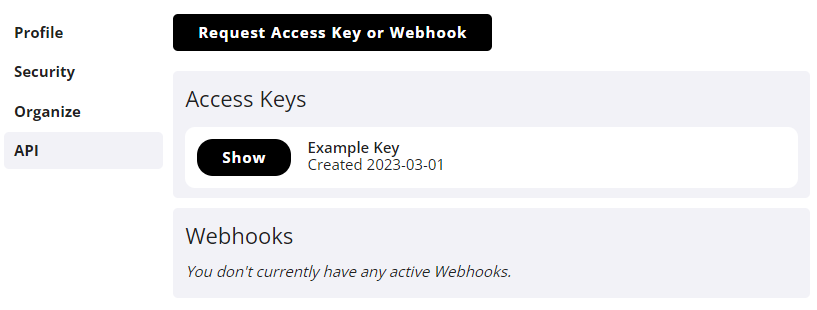

# Introduction

In this guide you can find all the information you need to make use of tournament data from the Limitless tournament platform. Our API provides several endpoints for accessing data like placings, decklists and matches, as well as a webhook system that can be used for updates on finished tournaments. 

::: info
If you run into any questions or issues, or have other feedback, join our **[Discord server](https://discord.gg/UG4zTC6)** and use the appropriate channels there.
:::

## Authentication
With the exception of the `/decks` endpoint in `/games`, **you do NOT need an API key to access the API**. Rate limits apply and can be checked through the rate limit response headers.

If you need a higher usage limit, or access to the decks endpoint, you can apply for an API key. However, these are not meant for private use, and are only given out to public-facing projects that have a legitimate use-case.

To request an API key, go to [your user API settings](https://play.limitlesstcg.com/account/settings/api) and fill out the form that is linked at the top.

Once approved, you can look up your key on that same page. When filling out the form, you can set a name for the key (e.g. the name of the app it is used for).

There are two accepted ways of adding your key to a request:
- Append it to the requested URL as a query parameter named *key*.
- Add it to the request as a HTTP header with the name *X-Access-Key*.

## Showcase
Here are some example applications that are built with tournament data from the Limitless platform.
* [Trainer Hill](https://www.trainerhill.com/) - In-depth metagame, decklist and matchup analysis for the Pokémon TCG
* [Pokemonmeta](https://www.pokemonmeta.com/) - Tier list, decklist analysis and winrates for the Pokémon TCG Pocket